<p align="center">
  
</p>

# MazeRunner

Proyecto de Matemáticas Discretas: comparación de algoritmos de búsqueda en grafos aplicados a videojuegos.

## Qué es

En muchos videojuegos el mapa es una cuadrícula y los personajes tienen que encontrar un camino de un punto a otro. Ese es un problema de grafos: cada casilla es un vértice, cada movimiento posible es una arista y el costo del terreno es el peso.

Este proyecto compara cinco algoritmos sobre esa idea: BFS, DFS, Dijkstra, la búsqueda voraz y A\*. Primero los estudia en un notebook, después los muestra en un mapa que se puede editar y al final los pone a competir en un juego, en 2D con Python y en 3D en el navegador.

Las reglas del mapa son las mismas en todo el proyecto:

- Solo hay movimiento en 4 direcciones: arriba, derecha, abajo e izquierda. No hay diagonales.
- Entrar a una casilla de llano cuesta 1, de bosque 3 y de agua 5. Los muros no se cruzan.
- En los dibujos, el inicio es un punto verde y la meta es una estrella.

Cada algoritmo se mide con tres números:

- **Casillas exploradas:** cuánto trabajó para encontrar la ruta.
- **Pasos:** cuántos movimientos tiene su ruta.
- **Costo:** cuánto cuesta recorrerla.

Para decidir cuál es la mejor opción en un mapa se usa un puntaje, y gana el más bajo:

```
puntaje = costo * 10000 + casillas exploradas
```

Primero cuenta la calidad de la ruta y después el esfuerzo de buscarla. Las casillas exploradas solo deciden cuando el costo empata.

## Los cinco algoritmos

Los cinco hacen lo mismo: guardan las casillas pendientes en una estructura, sacan una, la exploran y meten a sus vecinas. Lo único que cambia es qué casilla sale primero.

| Algoritmo | Estructura | Qué casilla sale primero | Ruta que encuentra | Cuánto explora |
| --- | --- | --- | --- | --- |
| BFS (búsqueda en anchura) | Cola | La que lleva más tiempo esperando | La de menos pasos | Mucho |
| DFS (búsqueda en profundidad) | Pila | La última que se descubrió | Cualquiera, suele ser mala | Depende de la suerte |
| Dijkstra | Cola de prioridad | La de menor costo acumulado desde el inicio | La de menor costo | Mucho |
| Voraz | Cola de prioridad | La que parece más cerca de la meta | Sin garantía | Muy poco |
| A\* | Cola de prioridad | La de menor costo acumulado más estimación hasta la meta | La de menor costo | Poco |

La estimación que usan el voraz y A\* es la distancia en casillas hasta la meta, sin diagonales. Nunca se pasa del costo real, porque cada paso cuesta al menos 1. Por eso A\* llega a la misma ruta barata que Dijkstra explorando menos.

## Qué hay en cada archivo

| Archivo | Qué es |
| --- | --- |
| `fase1_investigacion.ipynb` | El notebook de la investigación. Construye el mapa como grafo, programa los cinco algoritmos a mano, los compara en cuatro mapas (campo abierto, terrenos mezclados, laberinto y sin solución), explica por qué A\* no se equivoca, estudia el problema de recoger varios objetos, define el puntaje y cierra con las conclusiones. Trae un mapa para editar. NetworkX se usa solo para dibujar los grafos y para comprobar los resultados. |
| `funciones.html` | Una página que explica cada función del notebook paso a paso: sus entradas, su salida, el renglón de código que se ejecuta y cómo cambia cada variable. Trae sus propios mapas de ejemplo. |
| `fase2_editor.py` | El mapa editable. Una ventana donde se pinta el mapa con el ratón y, a un lado, una tabla que compara los cinco algoritmos y se vuelve a calcular con cada cambio. El mapa se puede ver como cuadrícula o como grafo. |
| `fase3_juegos.py` | Los juegos en 2D: portada, menú, tres juegos, sus versiones de solo mirar y el modo Aprender. |
| `index.html` | Los juegos en 3D para el navegador, con las mismas reglas y los mismos números que la versión de Python. Dibuja con WebGL, sin bibliotecas. |
| `portada.svg` | La animación que encabeza esta página. |
| `requirements.txt` | Las bibliotecas de Python que se necesitan, con su versión. |

## Cómo ejecutarlo

Se necesita Python 3.10 o posterior. Desde la carpeta del proyecto, las bibliotecas se instalan una sola vez:

```
pip install -r requirements.txt
```

Después, cada parte se abre por separado:

| Parte | Cómo se abre |
| --- | --- |
| Notebook | `jupyter notebook fase1_investigacion.ipynb` |
| Página de funciones | Abrir `funciones.html` en el navegador |
| Mapa editable | `python fase2_editor.py` |
| Juegos en 2D | `python fase3_juegos.py` |
| Juegos en 3D | Abrir `index.html` en el navegador |

Las dos páginas no necesitan Python ni instalar nada: basta un navegador. El juego 3D requiere que el navegador soporte WebGL.

### Mapa editable

| Control | Qué hace |
| --- | --- |
| Clic izquierdo, o arrastrar | Pinta con el pincel elegido |
| Clic derecho, o arrastrar | Borra: deja llano y quita objetos |
| Teclas 1 a 7 | Eligen el pincel: llano, bosque, agua, muro, inicio, meta y objeto |
| Clic en un renglón de la tabla | Elige el algoritmo que se muestra |
| Espacio | Anima la exploración del algoritmo elegido |
| V | Cambia la velocidad de la animación |
| G | Cambia entre la vista de cuadrícula y la de grafo |
| L | Limpia el mapa |
| R | Vuelve al mapa de ejemplo |

### Los juegos

Los rivales se mueven con los cinco algoritmos, cada uno con su color y su forma de caminar. El costo del terreno es tiempo: cruzar bosque tarda 3 veces más que cruzar llano y cruzar agua 5 veces más. El jugador avanza a 5.0 casillas por segundo y los rivales a 4.4 (4.3 en captura la bandera). Cada vez que un rival planea una ruta se queda quieto 0.008 segundos por cada casilla que exploró, y la mitad de eso en Maze Runner. Así el algoritmo que explora de más pierde tiempo y se le puede ganar.

| Modo | De qué trata |
| --- | --- |
| Atrapa gemas | Cada competidor corre en su propio tablero de 9 x 9, todos idénticos, y recoge las mismas 8 gemas en el mismo orden. Gana quien termine primero. |
| Captura la bandera | Uno contra uno en un tablero de 17 x 11: hay que robar la bandera del rival y llevarla a donde está la propia. Gana quien llegue a 3 puntos. El rival se elige entre los cinco algoritmos o al azar. |
| Maze Runner | Un laberinto de 21 x 31 casillas, el mismo para todos, que cambia cada 3 segundos. Gana quien llegue primero a la salida. |
| Mirar | Una versión de cada juego en la que compiten solo los algoritmos y la vista se mueve con libertad. En captura la bandera se elige el algoritmo de cada lado. |
| Aprender | Un algoritmo paso a paso sobre uno de cinco mapas, con su código, su estructura de datos dibujada y una tabla que compara a los cinco. |

Controles al jugar:

| Control | Qué hace |
| --- | --- |
| Flechas o W A S D | Mueven al personaje, casilla por casilla |
| C | Acerca la vista al personaje, o la regresa |
| R | Reinicia la partida |
| Espacio o Enter | Otra partida, cuando ya terminó |
| Esc | Regresa al menú |
| 1 a 6 | Eligen al rival en captura la bandera: BFS, DFS, Dijkstra, Voraz, A\* o Azar |
| Flechas izquierda y derecha | En Maze Runner, cuando ya llegaste, pasan la vista de un competidor a otro |

Controles al solo mirar:

| Control | Qué hace |
| --- | --- |
| Rueda del ratón | Acerca y aleja |
| Arrastrar | Desplaza la vista en 2D y gira la cámara en 3D |
| W A S D | Mueven la vista |
| Tab | Pasa a seguir a otro personaje |
| 0 | Vuelve a la vista general |
| Mayús + 1 a 5 | En captura la bandera, eligen el algoritmo del lado izquierdo |
| R y Esc | Reinician la partida y regresan al menú |

Controles del modo Aprender:

| Control | Qué hace |
| --- | --- |
| 1 a 5 | Eligen el algoritmo |
| M | Pasa al siguiente mapa |
| Flechas izquierda y derecha | Paso anterior y paso siguiente |
| Espacio | Avance automático, o pausa |
| V | Cambia entre las tres velocidades |
| R | Vuelve al primer paso |
| Esc | Regresa al menú |

En la versión 3D el modo Aprender tiene además botones en pantalla para lo mismo. Al terminar la búsqueda, el personaje del algoritmo recorre la ruta que encontró.

### En teléfono

El juego 3D también funciona en teléfonos, en horizontal. Si el teléfono está en vertical, aparece una pantalla que pide girarlo y el juego queda en pausa. Para jugar hay una cruceta en pantalla y tres botones: acercar la cámara, reiniciar y volver al menú. En los modos de mirar, un dedo gira la cámara y pellizcar acerca o aleja.

## Resultados

Estas tablas salen del modo Aprender, que compara a los cinco algoritmos en el mapa elegido. Todos los mapas del modo miden 12 x 8 casillas. En negritas, el mejor según el puntaje.

**Pantano.** Entre el inicio y la meta hay un bloque de agua. Cruzarlo es corto pero caro.

| Algoritmo | Exploradas | Pasos | Costo | Puntaje |
| --- | ---: | ---: | ---: | ---: |
| BFS | 65 | 9 | 25 | 250065 |
| DFS | 26 | 25 | 25 | 250026 |
| Dijkstra | 77 | 13 | 13 | 130077 |
| Voraz | 10 | 9 | 25 | 250010 |
| **A\*** | **21** | **13** | **13** | **130021** |

BFS y el voraz cruzan el agua: 9 pasos, pero costo 25. Dijkstra y A\* la rodean: 13 pasos y costo 13. Menos pasos no significa menos costo. Dijkstra y A\* empatan en costo y los separa el trabajo: 77 casillas exploradas contra 21. Es la búsqueda que se ve en la animación de arriba.

**Pared.** Una pared en forma de U queda entre el inicio y la meta, con agua en uno de sus lados.

| Algoritmo | Exploradas | Pasos | Costo | Puntaje |
| --- | ---: | ---: | ---: | ---: |
| BFS | 81 | 15 | 27 | 270081 |
| DFS | 26 | 25 | 37 | 370026 |
| Dijkstra | 70 | 15 | 15 | 150070 |
| Voraz | 32 | 15 | 27 | 270032 |
| **A\*** | **43** | **15** | **15** | **150043** |

El voraz se mete en la pared y sale por el lado del agua: explora poco, 32 casillas, y paga 27. A\* explora más que él, 43 casillas, y paga 15, porque rodea por el lado barato. Usan la misma estimación, pero el voraz no toma en cuenta lo que ya gastó.

A\* no gana siempre. En el mapa de laberinto los cinco llegan al mismo costo, 17, y el puntaje más bajo es de DFS y el voraz, que empatan con 18 casillas exploradas contra 30 de A\*. Y en el mapa sin salida nadie tiene puntaje: los cinco revisan las mismas 87 casillas, todas las que se pueden alcanzar, antes de concluir que no hay camino.

## Conclusiones

- Un mapa de cuadrícula es un grafo, y encontrar un camino en un videojuego es un problema de búsqueda en grafos.
- Menos pasos no es menos costo. En cuanto los terrenos cuestan distinto, BFS deja de ser confiable.
- A\* llega a la misma ruta barata que Dijkstra explorando menos, porque su estimación nunca se pasa del costo real.
- El voraz usa la misma estimación y sí se equivoca, porque no toma en cuenta lo que ya gastó.
- Cuando no hay camino, todos trabajan lo mismo: hay que revisar todo lo alcanzable para estar seguro.
- Para un videojuego, A\* es la mejor opción cuando importa la calidad de la ruta. El voraz sirve cuando lo que importa es responder rápido y una ruta imperfecta es aceptable.
